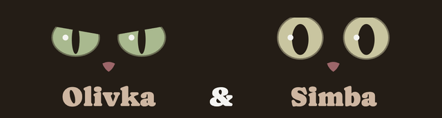

<!--
  TODO(Maryna): this is a draft written for you to edit. Read it out loud,
  change anything that doesn't sound like you, and delete this comment.
  Also decide how you want to mention that you built this with an AI pair
  programmer.
-->

# Olivka & Simba

**Live site: https://mn1rvana.github.io/olivka-and-simba/**



A small website about my two golden British Shorthairs, Olivka and Simba. You can meet them, look through their photos, test whether you can tell them apart, and blink slowly at them, which is how cats say they trust you.

## Stack

- Next.js 16 (App Router, static export), React 19, TypeScript in strict mode
- CSS Modules and CSS custom properties, written by hand
- [motion](https://motion.dev) for layout and shared-element animation
- [sharp](https://sharp.pixelplumbing.com) for the image pipeline
- Vitest, React Testing Library and axe-core for tests
- ESLint, Prettier, GitHub Actions, GitHub Pages

## Decisions I made, and why

### Next.js, exported as plain files

GitHub Pages can only serve static files, so `next build` exports the whole site to `out/` (`output: 'export'`), with no server at runtime. The page is a server component. At build time it renders the cats' sections, photos and gallery to HTML, so they're there before any JavaScript runs. Only the parts that react to you (the hero, the gallery, the game) are client components, and they hydrate in the browser.

The tricky part was hydration. The static HTML and the browser's first render have to match, and three things only exist in the browser: the `?cat=` filter in the URL, the game's random photo plus your saved best streak, and today's date (for the cats' ages). The filter reads the URL through `useSyncExternalStore`, which has a separate server value. The game starts after mount. The age is worked out in the browser. A test renders the page to HTML the way the build does, hydrates it, and fails on any mismatch.

Fonts go through `next/font/local`, using the Fontsource files. They're preloaded, and the fallback fonts get adjusted metrics, so text doesn't jump when the real font arrives. The icon and the link-preview image are files in `src/app/`, and Next writes their tags, base path included.

### The colors come from the cats

I didn't pick a palette. I measured one. A small script reads photos of Olivka and Simba and takes the median color of regions like their irises, their coats, Olivka's chin and Simba's nose. Every text and background pair is checked against WCAG AA. The obvious background, Simba's chest fur, turned out to be exactly the beige every generated site uses, so the page background is Olivka's chin, which is cooler. Everything is in [docs/design.md](docs/design.md).

### Photos go through a pipeline before they reach the repo

Photos from a phone carry GPS coordinates. Originals stay in a gitignored folder. `npm run photos` rotates them upright from their EXIF orientation, then writes AVIF and WebP at 480, 960 and 1600 px with no metadata at all. It also writes a manifest with each photo's size and a tiny blurred placeholder. `npm run photos:check` proves no EXIF or GPS survived, and CI runs it on every push. Because the manifest has every width and height, the browser reserves space before any image arrives, so nothing on the page jumps.

### The lightbox is a native `<dialog>`

`showModal()` makes the rest of the page inert, so focus can't wander behind the photo, and Esc closes it. I didn't need a focus-trap library. What I added myself: focus goes back to the thumbnail that opened it, ←/→ and swipe move between photos, and a live region announces "Photo 2 of 5" for screen readers, since arrow keys don't move focus. The gallery filter is plain radio buttons in disguise, so it behaves like any radio group, and the chosen filter lives in the URL (`?cat=simba`) so it can be shared.

### Motion only answers something you did

There's one bold moment: press "Blink slowly at them" and the cats blink back, Simba straight away and Olivka a beat later. Everything else is quieter and only shows what changed: photos slide into place when the filter changes, and a photo grows out of its thumbnail when it opens. It's all `transform` and `opacity`. If your system asks for reduced motion, nothing moves and the blink becomes a short fade. I checked it with the CPU slowed down 4×, and there were no long frames.

### Tests describe behaviour, not markup

There are 58 tests and no snapshots. The rules live in pure functions: the filter, and the game as a reducer with its randomness passed in. React Testing Library tests use the site the way a keyboard user would. axe checks the page in three states. One test fails if a photo still has placeholder alt text. In CI, the deploy job only runs after formatting, lint, types, tests, the photo check and the build all pass.

The most useful bug I found wasn't from a tool. motion's press animation was quietly making each filter label an extra Tab stop. axe was happy with it. I wrote a test that failed, then fixed it.

Lighthouse on a mobile profile, production build: Performance 96, Accessibility 100, Best Practices 100, SEO 100, with layout shift at 0.

## What I'd do next

- Add more photos, including some of the two of them together.
- Ship less JavaScript. The page loads about 230 kB gzipped, mostly React and the Next.js runtime. I tried motion's `LazyMotion` and measured no saving, because Next still references the split chunk from the page, and the eyes' `useAnimate` needs the animation engine anyway.
- Add Playwright tests in real browsers for what jsdom can't check: dialog inertness, reduced motion, real layout.
- Add a Ukrainian and a Polish version.

## Running it locally

You need Node 24 (see `.nvmrc`).

```bash
nvm use
npm ci
npm run dev
```

Then open http://localhost:3000/olivka-and-simba.

| Command                | What it does                                                  |
| ---------------------- | ------------------------------------------------------------- |
| `npm test`             | Runs the tests once (`npm run test:watch` keeps them running) |
| `npm run lint`         | ESLint with type-aware rules                                  |
| `npm run build`        | Type-checks and exports the static site to `out/`             |
| `npm run photos`       | Optimizes originals from `raw-photos/` into `public/photos/`  |
| `npm run photos:check` | Fails if any optimized photo still has metadata               |
| `npm run share-images` | Rebuilds the link-preview image and the home-screen icon      |
